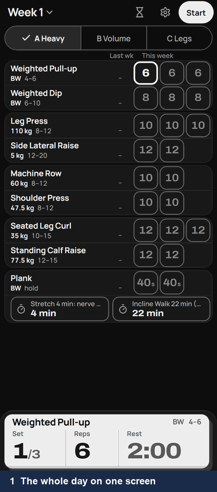
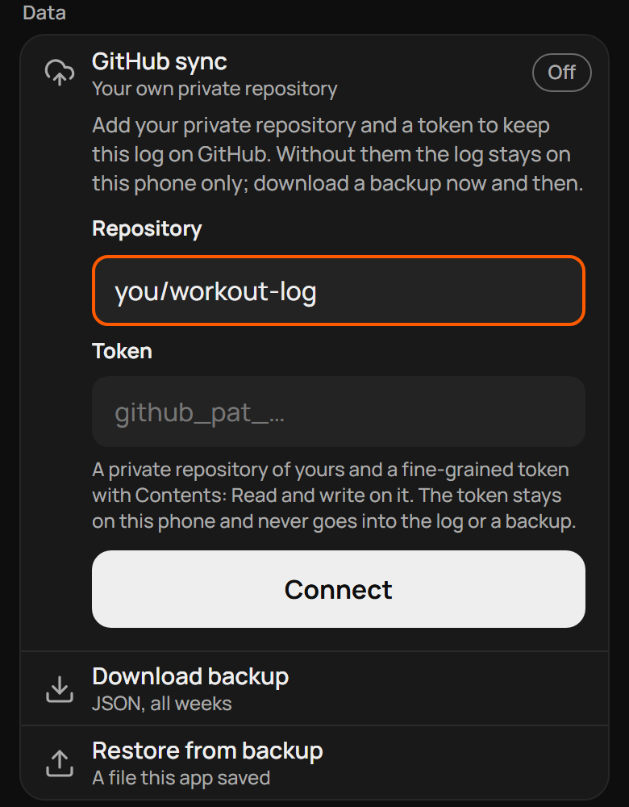
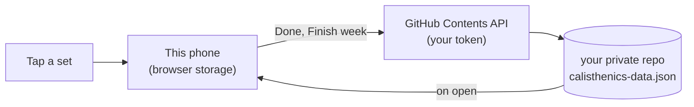

# Sthenos

[](https://estaed.github.io/Sthenos/)
[](#run-or-fork-it-locally)
[](LICENSE)

**A gym log for your phone: the whole day's workout on one screen, a set logged with one tap, and loads that go
up on their own when you hit the top of the range.**

<p align="center">
  
</p>

You walk into the gym and open Sthenos. Today is A Heavy: pull-ups 3 × 6, dips 3 × 8, and so on, each set a
cell. Finish a set, tap its cell, and the rest timer starts. Only got 7 dips? Tap the cell again. At the end of
the week, every lift where you hit the top of its rep range gets heavier next week.

- **What it does:** weeks of training with sets, reps, load and rest; a workout clock from Start to Finish; double
  progression when you finish the week; a separate stopwatch and countdown.
- **Why you can trust it:** it works offline in the gym, keeps everything on your phone, needs no account, and
  sends nothing anywhere unless you connect your own GitHub repository.
- **Who decides:** you. Finish week is a button, not a schedule, and any exercise's load, target, sets and range
  can be changed with a tap on its name.

Built by Tarık ([Estaed](https://github.com/Estaed)) for his own training, open for anyone; MIT licensed. It
starts with his A/B/C program; your log is yours alone.

## Quick start

### 1. Open it and put it on your home screen

Open **<https://estaed.github.io/Sthenos/>** on your phone. Then add it to the home screen, so it opens full
screen and works without signal:

- **Chrome (Android):** menu ⋮ → *Add to Home screen* (or *Install app*).
- **Samsung Internet:** menu ☰ → *Add page to* → *Home screen*.
- **Safari (iPhone):** Share → *Add to Home Screen*. (Built and tested on Android; iPhone is untested.)

The first open sets up week 1. In Settings (the gear), tap **Allow** under Notifications so the rest alert can
reach you with the screen off; without it, keep *Keep screen awake* on.

### 2. Make the program yours

Today the app starts from the built-in A/B/C program (three days, about ten exercises each). Tap an exercise's
**name** to change its load, target reps (or seconds), number of sets, rep range, load step and name. A change
holds for this week and the weeks after; earlier weeks keep what you did.

A program editor (new programs, adding, removing and reordering exercises and days, importing a program file)
is the next piece of work and is not in the app yet. Until then, a fork can ship its own starting program
([below](#run-or-fork-it-locally)).

### 3. Log a workout

| Do | What happens |
|---|---|
| **Start** | The workout clock starts. |
| Tap a set | Done at its target; the rest timer starts (2:00 between sets, Settings changes it). |
| Tap it again | One less, down to 0, then empty. |
| Hold it | One more. |
| **Finish** | The day's summary: time, sets, what moves up next week. **Done** closes the day. |
| **Week 1**, top left | Every week; **Finish week** builds the next one with the progression below. |

The hourglass opens a stopwatch and a countdown that run beside the rest timer.

### 4. Optional: keep your log in your own private GitHub repository

Without this, the log lives only in this browser on this phone; **Settings → Download backup** saves it as a
JSON file now and then. With it, every finished day becomes a commit in a repository only you can see, and a
second phone can pick it up.

1. **Make a private repository.** On GitHub, [New repository](https://github.com/new): any name (say
   `workout-log`), **Private**, and tick **Add a README file** so it has a `main` branch.
2. **Make a token that can reach only that repository.** [Fine-grained tokens → Generate new
   token](https://github.com/settings/personal-access-tokens/new):
   - *Repository access:* **Only select repositories** → pick `workout-log`.
   - *Permissions → Repository permissions → Contents:* **Read and write**. (GitHub adds *Metadata: Read-only*
     itself.) Nothing else.
   - Pick an expiry, **Generate token**, copy it (`github_pat_…`).
3. **Connect.** In Sthenos: gear → **Data → GitHub sync** → *Repository* `your-name/workout-log` (a pasted
   GitHub link works too) → *Token* → **Connect**. The pill says **Synced** and `calisthenics-data.json`
   appears in the repository.

<p align="center">
  
</p>

The token stays in this browser; it never goes into the log, a backup or the repository. When it expires,
sync says so: **Disconnect**, then Connect with a new token (the repository is remembered).

**When it talks to GitHub:** on open (to pick up changes), when you tap **Done** after a workout, on **Finish
week**, and at once after an edit to a finished day or the program. Sets logged mid-workout wait for Done. If
the phone and GitHub both changed, it asks which to keep; it never overwrites in silence, and GitHub's history
keeps every version.

## How it works



1. The app is static files on GitHub Pages; a service worker keeps a copy so it opens offline.
2. Your log is one JSON document in the browser's storage (`cali.v5`). Nothing is sent anywhere by default.
3. With sync on, the same document is written to `calisthenics-data.json` in your repository through GitHub's
   Contents API; each sync is a commit, so the repository's history is your training history.

<details>
<summary><b>Progression rules</b> (what Finish week does to each exercise)</summary>

- Every set at target → target + 1 rep.
- Past the top of the rep range → load + its load step, target back to the bottom of the range.
- Any short set → no change for that exercise.
- Short at the same load three weeks running → load − 10 %, rounded to the load step (no change at 0 added load).
- A day not done carries over unchanged and does not count toward the stall.
- Bodyweight lifts progress on the added load. Timed holds go up 5 s when every set hits target.
- Finish week can be undone until you log the first set of the new week.

</details>

<details>
<summary><b>What is stored where</b></summary>

| Where | What |
|---|---|
| `cali.v5` (browser storage) | The log: programs, weeks, days, every set with its time, settings. |
| `cali.sync` (browser storage) | Your repository name, token and sync marks. Never synced, never in a backup. |
| `cali.timers` (browser storage) | Running timers, as start times, so they stay right after the phone sleeps. |
| `calisthenics-data.json` in your repository | The same log as `cali.v5`, only if you connect sync. |

Clearing the site's data in the browser deletes the log on that phone. Download a backup or connect sync first.

</details>

## Run or fork it locally

No build step and no dependencies: it is HTML, CSS and JavaScript.

```sh
git clone https://github.com/Estaed/Sthenos.git
cd Sthenos
python -m http.server 8000
# open http://localhost:8000/ (a service worker needs localhost or https)
```

**Your own copy on GitHub Pages:** fork the repository, then *Settings → Pages → Deploy from a branch → `main`,
`/ (root)`*. It is served at `https://<you>.github.io/Sthenos/` with its own storage, separate from this one.

**A different starting program in your fork:** replace the program object in `app/default-program.js` (its
shape is in [`docs/blueprint.md`](docs/blueprint.md) → Data). It is read only when a phone opens the app for
the first time.

**Tests** (Playwright drives Chromium as a phone, with GitHub mocked):

```sh
pip install playwright
python -m playwright install chromium
python tests/acceptance.py   # every check PASS, exit 0
```

<details>
<summary><b>Project layout</b></summary>

| Path | What |
|---|---|
| `index.html`, `app/core.js` | The shell, the data document, its rules, routes and the feature loader. |
| `app/<feature>.js` + `.css` | One file per feature: `workout`, `summary`, `timer`, `alert`, `week`, `progress`, `settings`, `sync`. |
| `app/registry.js` | The list of feature files; the service worker caches the same list. |
| `sw.js`, `sw-alert.js`, `manifest.json` | Offline copy, the rest alert with the screen off, install. |
| `tokens.css`, `fonts/` | Design tokens and the Archivo and Manrope fonts (SIL Open Font Licence, `fonts/OFL-*.txt`). |
| `tests/` | The acceptance gate and one test file per feature. |
| `docs/`, `design/`, `reports/`, `tasks/`, `notes.md` | How it was planned and designed: the blueprint, design rounds, research and task files. |
| `legacy/` | The previous version of the app, kept for a short while and then removed. |

</details>

## Licence

[MIT](LICENSE). The fonts in `fonts/` are under the SIL Open Font Licence.
